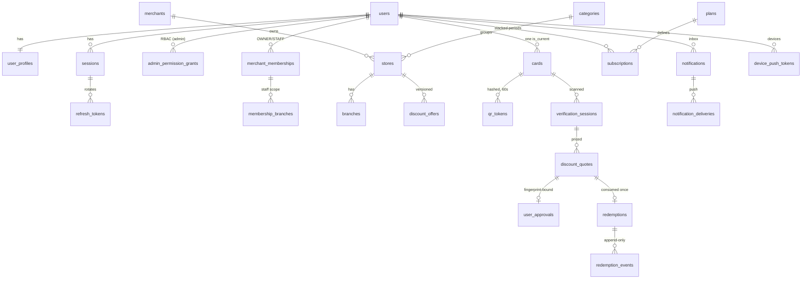

# Architecture & decisions

## Decisions (ADR summary)

| # | Decision | Why |
|---|---|---|
| 1 | **pnpm monorepo** (`apps/*`, `packages/shared`, `e2e`) with `node-linker=hoisted` | One lockfile; hoisting is what React Native/Metro expects. |
| 2 | **Modular monolith** (NestJS) — one API + one worker process sharing domain services | Enough for launch scale; no distributed-transaction problems in the redemption path. |
| 3 | **PostgreSQL is the source of truth for eligibility**; Redis only carries queues and rate-limit counters | The daily limit is a DB constraint, so it holds even if Redis is lost. |
| 4 | **Pinned, proven versions** instead of the newest majors: NestJS 11 (not 12), Prisma 6.19 (not 7), Next 15.5 (not 16), TypeScript 5.9 (not 7) | Checked on 2026‑09‑30. Newer majors had changed APIs/build tooling, and those changes weren't needed for launch. Upgrading is a separate task. |
| 5 | **Expo SDK 57** (current stable, RN 0.86, React 19.2.3) with **development builds** | Builds with Xcode 26 / iOS 26 SDK as App Store requires since 2026‑04‑28; native camera, SecureStore, notifications. React is aligned to 19.2.3 in admin too. |
| 6 | Admin uses a **server-side BFF** (Next.js route handlers) and HttpOnly/SameSite=Strict cookies; the browser never sees tokens | Removes token theft via XSS; CSRF handled by SameSite + Origin + custom header. |
| 7 | Admin UI built on **native semantic HTML** (tables, `<dialog>`, labelled inputs) instead of a component library | Accessible by default, small and dependency-light. Can be swapped for Radix later. |
| 8 | **Zod schemas in `packages/shared`** validate API input and drive OpenAPI (`zod-to-json-schema`) and client forms | One definition per payload. |
| 9 | **Money as integer agorot, rates as basis points**, `round_half_up` with BigInt | No floating point anywhere in money paths. |
| 10 | **Transactional outbox** for notifications/side effects | A push outage cannot undo or block a confirmed discount. |
| 11 | Profile photos in **private storage, streamed through the API** after a per-request authorization check | Stricter than presigned URLs (no shareable link at all). |
| 12 | Custom HS256 access tokens (15 min) + opaque rotating refresh tokens (per-session, reuse detection) | Sessions are checked on every request so revocation is immediate. |

## ERD (core)



Other tables: `email_tokens`, `invitations`, `store_images`, `idempotency_records`, `outbox_events`, `broadcasts`,
`audit_logs` (append-only), `account_deletion_requests`, `app_settings`. Full schema: `apps/api/prisma/schema.prisma`;
constraints: `apps/api/prisma/migrations/20260930000002_constraints/migration.sql`.

### Constraints that enforce business rules in the database
- `redemptions_daily_limit_uq` — UNIQUE `(user_id, store_id, business_date) WHERE status='CONFIRMED'`.
- `discount_offers_one_active_uq` — one ACTIVE offer per store; `cards_one_current_per_user_uq`.
- CHECKs on amounts (`net = gross − discount`, `eligible ≤ gross`, rate 1..10000 bps, currency ILS), void consistency, serial format.
- Triggers: `audit_logs` and `redemption_events` are append-only; `redemptions` financial fields are immutable and a VOIDED row can't be restored.

## Redemption flow

```mermaid
sequenceDiagram
  participant M as Member app
  participant S as Staff app
  participant A as API
  participant DB as PostgreSQL
  M->>A: POST /me/card/qr-token (60s, bound to card+session)
  S->>A: POST /merchant/verifications {branchId, qrPayload}
  A->>DB: atomically claim token (single use); check scope & membership
  A-->>S: holder name + photo (live session only)
  S->>A: POST /verifications/:id/match
  S->>A: POST /merchant/quotes {grossMinor, eligibleMinor?}
  A-->>S: server-computed quote + fingerprint
  M->>A: GET /me/approvals/pending → POST /approve {fingerprint}
  S->>A: POST /merchant/redemptions {quoteId} + Idempotency-Key
  A->>DB: BEGIN; reserve idempotency key; lock quote, card, user, subscription, offer; re-check all; INSERT redemption (unique index); outbox; COMMIT
  A-->>S: 201 redemption (replays return 200 + same body)
```
